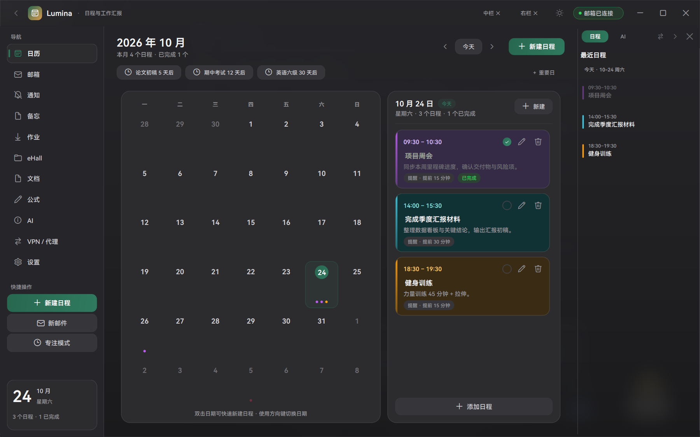
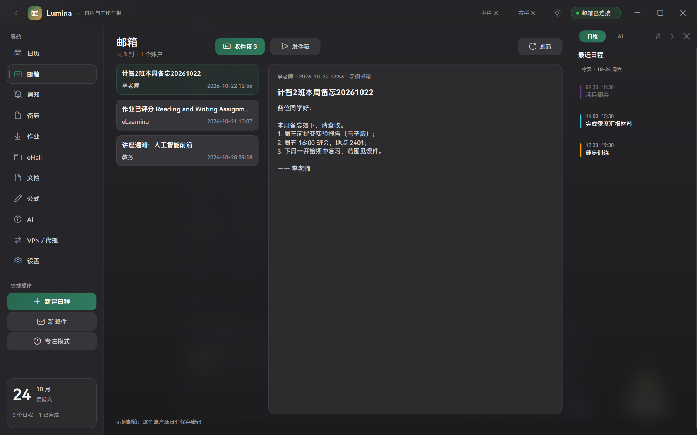
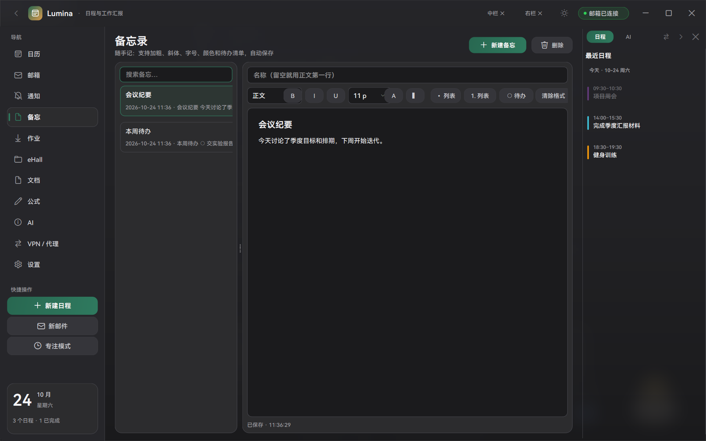
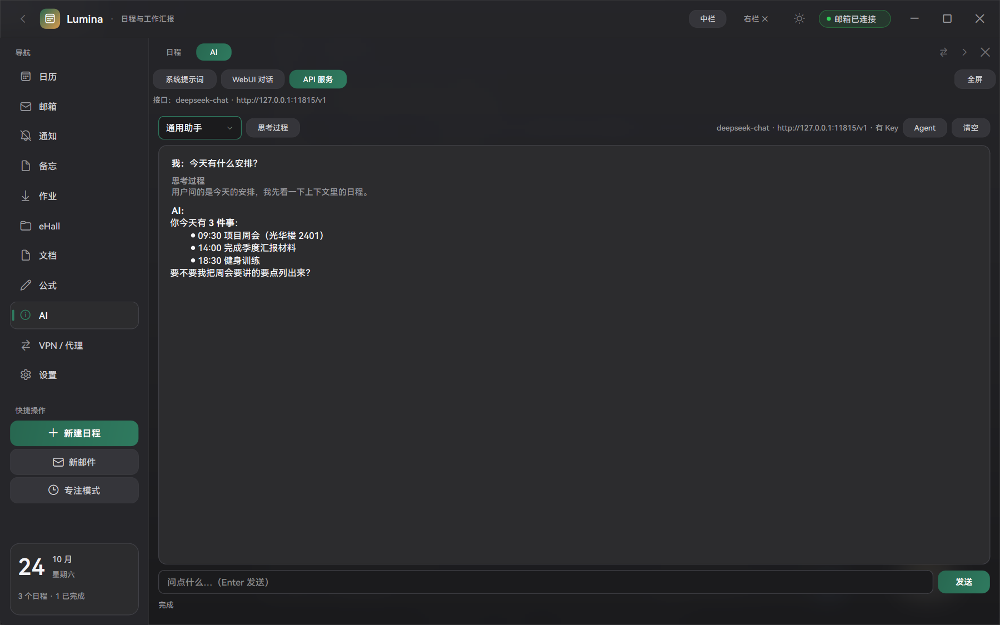
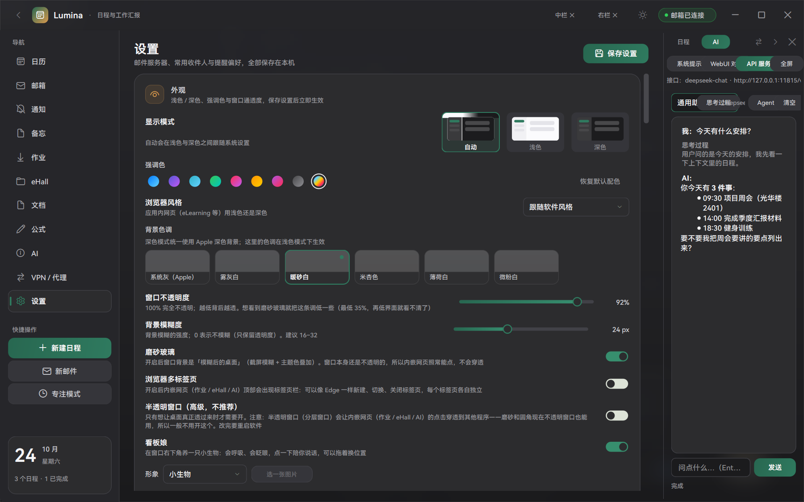

# Lumina · 日程与汇报

一个给「学生 / 科研党」用的 Windows 桌面工作台：**日历 + 邮箱 + 通知 + 备忘 + 作业 + 文档 + 公式 + AI + Agent** 集中在一个窗口里，数据全部存在本机。

> 纯 Python（PySide6 + QtWebEngine）写的原生桌面应用，不依赖 Electron；界面是自绘的圆角卡片 + 磨砂玻璃，支持浅色 / 深色。
> 版本：`1.0.0`　平台：Windows 10 / 11　Python 3.9+



---

## 目录

- [功能一览](#功能一览)
  - [日历与日程](#日历与日程)
  - [重要日（倒计时）](#重要日倒计时)
  - [邮箱：收件箱 + 发件箱](#邮箱收件箱--发件箱)
  - [通知](#通知)
  - [备忘](#备忘)
  - [作业 / eLearning](#作业--elearning)
  - [eHall（网上办事大厅）](#ehall网上办事大厅)
  - [文档与公式](#文档与公式)
  - [AI：三合一面板](#ai三合一面板)
  - [Agent：微信待办与发消息](#agent微信待办与发消息)
  - [效率与外观](#效率与外观)
- [技术栈与架构](#技术栈与架构)
- [安装与运行](#安装与运行)
- [首次配置](#首次配置)
- [快捷键](#快捷键)
- [数据、隐私与安全](#数据隐私与安全)
- [目录结构](#目录结构)
- [开发与测试](#开发与测试)
- [已知限制](#已知限制)
- [更新日志](#更新日志)

---

## 功能一览

| 模块 | 做什么 |
| --- | --- |
| 日历 | 月视图 + 当天面板 + 右侧最近日程，支持分组配色、提醒、自动完成、双击新建 |
| 重要日 | 期中考试 / 截止日这类「还差几天」的倒计时，显示在日历页顶部 |
| 邮箱 | 多账户 IMAP 收件箱（本地缓存、先本地后联网）+ SMTP 发件箱（汇报邮件 / 普通邮件、附件、签名） |
| 通知 | 抓取教务处通知，显示网页发布时间与抓取时间，未读标记 |
| 备忘 | 富文本随手记：第一行自动当标题、名称跟随第一行、待办勾选、自动保存 |
| 作业 | eLearning（Canvas）课程与作业列表、一键下载、内嵌网页 |
| eHall | 网上办事大厅内嵌浏览，登录态保留，统一身份认证自动填充 |
| 文档 | PDF / DOCX / PPTX 阅读，目录树、全文滚动、应用内全屏 |
| 公式 | 自然语言转 LaTeX、常用符号面板、实时预览、编译 / 导出 |
| AI | 三个标签：系统提示词 / WebUI 对话 / API 服务（流式回答 + 思考过程） |
| Agent | 读微信当前聊天（截图 OCR）→ 识别要加日程的事；也能按名字给指定的人发微信 |
| 效率 | 专注计时（含离开检测）、日程提醒弹窗、桌宠、位置 / 出发提醒、VPN 代理、文献管理 |

---

### 日历与日程


- **月视图**：每格显示当天日程的小圆点，颜色跟随分组；单击选中、双击直接新建。
- **当天面板**：右侧列出选中日期的日程卡片，可编辑、标记完成、删除。
- **分组**：课程表、考试、工作……分组配色会同步到月视图圆点和日程卡片。
- **提醒**：每个日程可选提前 5 / 10 / 15 / 30 / 60 分钟，到点弹圆角提醒卡（可「标记完成」或「稍后 10 分钟」）。
- **自动完成**：过了结束时间的日程自动标为已完成（可在设置里关闭）。
- **窄栏适配**：右栏太窄时日历自动切成「最近 5 天」清单。
- 支持 **中栏 / 右栏** 独立显隐、两栏位置互换（日程 / AI 搬到大区域）。

### 重要日（倒计时）

- 期中考试、论文截止、报名截止这类「日期 + 还剩几天」的事项单独管理：`设置里的日期写法`支持 `11-05`、`11月5日`、`明天`、`+14`。
- 日历页顶部显示最近 3 条：`论文初稿 5 天后`、`期中考试 12 天后`……点一下就能增删。
- 与「考试安排导入」联动：从教务读到的考试可以一键「同时设为重要日」。

### 考试安排

- 设置 → 课程表卡片 →「导入考试安排」：内嵌浏览器打开教务，登录后点「读取考试」。
- 识别「日期 + 时间范围 + 地点 + 座位」，解析结果进**可编辑确认页**（可逐行改名称/时间/地点，也可勾掉），确认后写入日历的「考试」分组。
- 重复导入按「标题 + 日期 + 开始时间」去重；可选同时建重要日倒计时。

### 邮箱：收件箱 + 发件箱



- **收件箱**：多账户 IMAP 合并列表；**先显示本地已收的邮件，再到后台收新的**（同一账户同 uid 唯一，正文读过一次也缓存，断网也能看）。
- 列表行：标题加粗 + 「发件人 · 时间」；发件人从 `名字 <地址>` 里取名字显示。
- **发件箱**：用任务与成果自动生成汇报邮件，也可以写普通邮件；支持附件、签名、草稿、失败重发、删除。
- 收件箱切回来有 90 秒冷却，不会反复连服务器；「刷新」按钮强制收一次。

### 通知

- 抓取教务处通知列表（支持 JS 渲染的页面），显示「发布于 / 抓取于」两种时间。
- 未读高亮、按关键词过滤、本月统计（默认不计课程表分组）。

### 备忘



- **第一行自动是标题**：13pt 加粗；标题行按回车后，新的一行自动是正文（10pt 不加粗）。
- **名称跟随第一行**：不填名称时，左侧列表就用第一行的文字；想换名字就在「名称」框里自己写。
- 选中文字后用工具栏改格式：正文 / 标题 / 副标题 / 一级小标题 / 二级小标题，加粗、斜体、下划线、字号、颜色、高亮。
- 待办清单：`○ / ●` 点一下切换完成；支持无序 / 有序列表、清除格式。
- 全程自动保存（停止输入 0.7 秒后落盘）。

### 作业 / eLearning

- 读取 eLearning（Canvas）的课程与作业列表，显示截止时间与提交状态。
- 一键下载某个作业的附件、或「下载全部作业」到本地目录。
- 内嵌 eLearning 网页：登录一次记住会话；顶部可切换「列表 / 网页」。

### eHall（网上办事大厅）

- 应用内打开 `ehall.fudan.edu.cn`，登录态保留；可回到首页、刷新、全屏。
- 页面隐藏时冻结渲染省 CPU，回来时自动重绘（不会出现空白）。
- 统一身份认证页支持**自动填充账号密码**（见下）。

### 文档与公式

- **文档**：底部「文档」页可以浏览文件夹、打开 PDF / DOCX / PPTX；PDF 支持翻页、缩放、目录；可在应用内全屏阅读。
- **公式**：输入自然语言或符号，转成 LaTeX；带希腊字母 / 运算符 / 矩阵面板、实时预览、导出 `.tex`、调用本地 LaTeX 编译。

### AI：三合一面板



右侧 AI 栏（`Ctrl+Shift+A`）分三个标签：

| 标签 | 说明 |
| --- | --- |
| **系统提示词** | 直接编辑 `data/prompts.json` 里的人设与场景提示词，保存即生效，可恢复默认 |
| **WebUI 对话** | 内嵌 DeepSeek / 豆包 / Kimi / 自定义站点，登录态保留；可自己添加网址或本地模型 Web UI |
| **API 服务** | 内置的流式对话窗口，不加载网页 |

「API 服务」对标 DeepSeek Harness Desktop 的基本体验：

- **流式输出**（SSE）：边生成边显示，不是等整段回来才出现；
- **思考过程**：DeepSeek-R1 / 豆包等返回 `reasoning_content` 时，单独一块灰底显示，可折叠；
- **停止生成**：随时中断，已生成的内容保留；
- **Markdown 渲染**：标题、列表、代码块、粗体都正常；
- 顶部显示当前模型 / 接口地址 / 是否填了 Key，可切换「通用助手 / 场景提示词」。

设置 → **AI 接口** 里配接口：

- 「接口服务」预设：本地模型 / DeepSeek / 豆包（火山方舟）/ Kimi / 自定义，选中即自动填好地址与模型名；
- 「模型名」+「API Key」（DPAPI 加密保存，界面不可回看）；
- 「测试接口」发一次真实请求验证连通；
- 云端预设下主按钮是「**配置 API 对话**」——在中栏打开 API 对话窗格；选本地模型时按钮变成「启动本地模型」。

### Agent：微信待办与发消息

Agent 窗口（AI 栏的「Agent」按钮，或 `Ctrl+Shift+G`）：

1. **读微信**：不用复制——勾选「允许直接读取微信」后点「读微信」，程序截取**当前打开的聊天窗口**，用 Windows 自带 OCR（简体中文）识别文字并清洗（去掉中文间隙、UI 噪声），再交给模型 / 规则提取「有时间、需要自己做」的事项。识别结果以**候选日程**列出，勾选确认后才写进日历。
2. **发微信**：给指定的人发一条消息，流程是两段确认：
   - 「预览会话」：Ctrl+F 搜索联系人 → 打开会话 → OCR 读会话标题 → 和你填的名字比对（不发送任何消息）；
   - 勾选「我知道会真的发出去」→「发送」：点击输入框 → 剪贴板粘贴 → 回车 → 再 OCR 校验。
   - 标题对不上（发错人）会直接中止，不会点击输入框、不会粘贴。

> 微信 4.x 没有公开接口、UI Automation 树也是空的，所以「读」用截图 OCR、「写」用模拟操作 + 剪贴板粘贴；所有关键动作都有二次校验。

### 效率与外观

- **专注计时**：不定时 / 25 / 45 / 60 分钟，桌面悬浮倒计时，离开太久会提醒。
- **桌宠**：窗口上一只小生物，会呼吸眨眼，可拖着换位置、换形象（蛋 / 史莱姆 / 猫 / 幽灵 / 像素 / 自定义图片）。
- **位置与出发提醒**：Wi-Fi 指纹 + Windows 定位估算当前位置，按步行 / 骑行速度提前提醒「该出发了」。
- **VPN / 代理**：支持代理设置与连通性测试，内嵌网页与请求都走代理。
- **文献**：BibTeX / RIS 解析、DOI 走 Crossref 抓取、导出给 EndNote。
- **外观**：浅色 / 深色 / 跟随系统、强调色、多种背景色调、
  **磨砂玻璃**（截屏模糊实现，窗口本身不透明，内嵌网页照常能点）、
  窗口不透明度（35%–100%，拖动实时预览）、圆角与系统投影、字体设置。

---

## 技术栈与架构

- **UI**：PySide6（Qt 6）自绘控件，无第三方 UI 框架；内嵌网页用 QtWebEngine（每个站点独立 profile + 持久 cookie）。
- **数据**：SQLite 单文件（`data/lumina.db`），WAL 模式；提示词等配置存在 `data/prompts.json`。
- **安全**：所有密码 / API Key 走 Windows DPAPI 加密后存在库里（`lumina/secure.py`），界面只可修改、不可查看。
- **系统集成**：Win32（窗口截图 `PrintWindow`、`SendInput` 模拟按键、`SetWindowDisplayAffinity`、DWM 圆角 / 投影 / 磨砂）、Windows OCR（PowerShell + WinRT `Windows.Media.Ocr`）。
- **AI**：任何 OpenAI 兼容接口（`/chat/completions`，支持 `stream=true`），内置服务预设。

```
main.py               入口：单实例锁、字体渲染、主题、启动主窗口
lumina/
  main_window.py      主窗口：三栏布局、标题栏、面板显隐 / 互换、全屏
  store.py            SQLite 数据层（日程 / 邮件 / 备忘 / 通知 / 分组 / 设置）
  theme.py            外观：调色板、QSS、字体、磨砂与不透明度
  widgets.py          基础控件（卡片、按钮、下拉、滚动区、开关……）
  page_calendar.py    日历页 + 当天面板 + 倒计时条
  panel_agenda.py     右侧栏「日程」
  right_dock.py       右侧栏容器（日程 / AI 切换、折叠、宽窄拖拽）
  page_mailbox.py     邮箱页（收件箱 / 发件箱切换）
  inbox_panel.py      收件箱面板（本地缓存 + 后台收信 + 正文缓存）
  page_outbox.py      发件箱（汇报邮件 / 草稿 / 失败重发）
  imap_inbox.py       IMAP 多账户收信 + 本地缓存
  mailer.py / sending.py / dialogs.py   SMTP 发信与写信窗口
  page_notices.py / notices.py          通知抓取与展示
  page_memos.py       备忘录（富文本、标题行、待办）
  page_homework.py / elearning.py       作业与 eLearning
  page_ehall.py / web_panel.py          eHall 与通用内嵌浏览器
  page_docs.py / docs_reader.py         文档阅读（PDF / DOCX / PPTX）
  page_latex.py / latex_*.py            公式与 LaTeX
  ai_panel.py         AI 三标签容器
  ai_api_panel.py     API 服务：流式对话窗格
  ai_prompt_panel.py  系统提示词编辑
  ai_chat.py          OpenAI 兼容客户端（流式 / 非流式）
  agent.py / agent_dialog.py            微信待办识别与确认
  wechat_read.py / wechat.py            微信截图 + 系统 OCR 读消息
  wechat_send.py / wechat_send_dialog.py 给指定人发消息
  exams.py / exam_dialog.py             考试安排导入
  important.py / important_dialog.py    重要日倒计时
  focus.py / mascot.py / reminders.py   专注、桌宠、提醒
  vpn.py / geo.py / positioning.py / wifi_scan.py / location_win.py  网络与定位
  refs.py / fdu.py / timetable.py / uis_login.py  文献、教务课表、统一身份认证
  settings_dirs.py / config.py / secure.py / win_effects.py  配置、加密、窗口特效
```

---

## 安装与运行

**要求**：Windows 10 / 11、Python 3.9+（推荐 3.11 或 3.12）、约 300 MB 磁盘（PySide6 比较大）。

```powershell
git clone <this-repo>
cd Lumina
python -m pip install -r requirements.txt
python main.py
```

或者直接双击 **`启动 Lumina.bat`**（会自动检查 Python 和 PySide6，缺依赖就先装）。
调试时用 **`调试运行.bat`**，会保留控制台看报错。

> 首次启动会在程序目录下创建 `data/`（数据库、浏览器配置、日志），第二次启动开始就有示例日程。

---

## 首次配置



大部分功能开箱可用（日历、备忘、通知），下面几项按需配置：

1. **AI 接口**（设置 → AI 接口）
   选一个服务（如 DeepSeek）→ 会自动填好地址和模型名 → 粘贴 API Key → 点「测试接口」→ 通过后点「配置 API 对话」开始用。
2. **发件邮箱（SMTP）**：填服务器、端口、账号、**授权码**（不是登录密码），保存后状态栏会变成「邮箱已连接」。
3. **收件箱（IMAP）**：可添加多个邮箱账户，收件箱里合并显示；密码同样加密保存。
4. **统一身份认证（UIS）**：填学号和密码后，内嵌网页遇到登录页会**自动填好账号密码**，你点一下「登录」即可（有二次验证就手动过一次）。
5. **教务课表 / 考试**：设置 → 课程表卡片 →「登录教务抓取课表」/「导入考试安排」，在内嵌浏览器里登录后抓取。
6. **微信相关（可选）**：需要本机微信在运行；「读微信」用系统 OCR，「发微信」用模拟操作 + 剪贴板，均在 Agent 窗口里确认后才执行。

---

## 快捷键

| 快捷键 | 作用 |
| --- | --- |
| `Ctrl+1` … `Ctrl+8` | 切换到日历 / 邮箱 / 通知 / 备忘 / 作业 / eHall / 文档 / 公式 |
| `Ctrl+9` | 设置 |
| `Ctrl+N` | 新建日程 |
| `Ctrl+Shift+N` | 写新邮件 |
| `Ctrl+R` | 刷新全部数据 |
| `Ctrl+Shift+A` | 打开右侧 AI 面板 |
| `Ctrl+Shift+G` | 打开 Agent（微信待办 / 发消息） |
| `Ctrl+Shift+L` | 中栏 / 右栏位置互换 |
| `Ctrl+Alt+M` / `Ctrl+Alt+R` | 显示 / 隐藏中栏 / 右栏 |
| `Esc` | 退出面板全屏 / 关闭浮层 |

> 强调色、背景色调、字体等都在「设置 → 外观」里，改完立即生效。

---

## 数据、隐私与安全

- 所有数据都在本机：`data/lumina.db`（SQLite）、`data/browser/`（各站点网页登录态）、`data/prompts.json`。
- **密码 / API Key / 授权码** 全部用 Windows DPAPI 加密存储（跟当前 Windows 账号绑定），数据库被拷走也解不开；界面上只能修改、看不到原值。
- 程序不向任何服务器上传你的日程、邮件、备忘；只有你主动使用的 AI 接口会把对话内容发给你选定的服务商。
- 微信相关功能**不读取微信数据库、不登录微信**：只截当前聊天窗口做本地 OCR，发消息也只是模拟点击和粘贴。
- 换电脑：把 `data/` 一起拷走即可（密码需要重新输入，因为 DPAPI 与本机账号绑定）。

---

## 目录结构

```
.
├─ main.py                     程序入口
├─ lumina/                     全部源码（见上面的架构说明）
├─ assets/                     字体、图标
├─ docs/                       README 用截图
├─ tools/                      开发小工具（示例数据、截图、自检）
├─ requirements.txt
├─ build_exe.ps1               打包成 exe（PyInstaller）
├─ 启动 Lumina.bat             双击启动（自动装依赖）
└─ 调试运行.bat                带控制台启动，方便看报错
```

---

## 开发与测试

```powershell
# 语法检查
python -m compileall lumina

# 冒烟测试：离屏启动 → 建好所有页面 → 1.2 秒后自动退出
python main.py --smoke-test

# 换数据目录（测试不会污染自己的数据）
$env:LUMINA_DATA_DIR = "D:\tmp\lumina-test"
python main.py
```

- `tools/test_core.py`：数据层 / 邮件组装等核心逻辑自测。
- `tools/test_flows.py`：主要业务流程自测。
- `tools/test_theme.py`：主题与外观计算自测。
- `tools/gen_icon.py` / `tools/build_docs.py`：生成图标、生成文档资源。

调试小技巧：`--allow-multi` 可以跳过单实例锁；`LUMINA_FONT_ENGINE=directwrite` 可切回系统字体渲染。

---

## 已知限制

- **仅 Windows**：大量功能依赖 Win32 / DWM / Windows OCR。
- **圆角与磨砂**：圆角用 Win11 的 DWM，Win10 上是方角；磨砂是「截屏模糊 + 主题色」，所以窗口背后的内容快速移动时最多有几秒延迟（想要真实时透明只能开「半透明窗口」，但那样内嵌网页会点击穿透，所以默认关闭）。
- **微信**：微信 4.x 没有接口，读消息靠截图 OCR，小字号中文会有错字；发消息靠模拟操作，需要微信在前台，联系人名字要和会话标题对得上（对不上会中止）。
- **统一身份认证**：新版 `id.fudan.edu.cn` 是前端加密的单页应用，程序不做后台登录，只在网页里自动填表；遇到短信 / 扫码二次验证需要手动过一次。
- **教务 / eLearning**：需要在内嵌网页里登录一次，之后靠持久 cookie。
- **AI**：需要自备 OpenAI 兼容接口（云端 Key 或本地模型）。

---

## 更新日志

### 1.0.0

- 三栏工作台（左导航 / 中栏内容 / 右栏日程与 AI），中栏右栏可独立显隐、可互换、可全屏。
- 日历与日程：月视图、当天面板、分组配色、提醒弹窗、自动完成、重要日倒计时。
- 邮箱：多账户 IMAP 收件箱（本地优先 + 正文缓存）、SMTP 发件箱（汇报邮件 / 普通邮件 / 附件 / 签名）。
- 通知抓取（含网页发布时间）、备忘录富文本（第一行即标题、名称跟随第一行、待办勾选）。
- 作业 / eLearning 下载、eHall 内嵌、文档阅读（PDF / DOCX / PPTX）、公式与 LaTeX。
- AI 三标签（系统提示词 / WebUI 对话 / API 服务），流式回答 + 思考过程 + 停止生成 + Markdown。
- 服务预设与「测试接口」、云 API 与本地模型一键切换。
- Agent：微信当前聊天截图 OCR → 待办识别 → 确认写入日程；按名字发微信（预览校验 + 二次确认）。
- 考试安排导入（可编辑确认）、统一身份认证网页自动填充。
- 磨砂玻璃 / 不透明度 / 圆角 / 强调色 / 字体等外观设置，专注计时、桌宠、位置与出发提醒、VPN 代理、文献管理。

---

## License

个人项目，未指定开源协议；如需使用请先联系作者。
