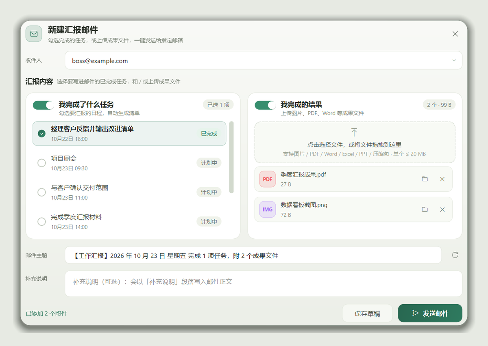
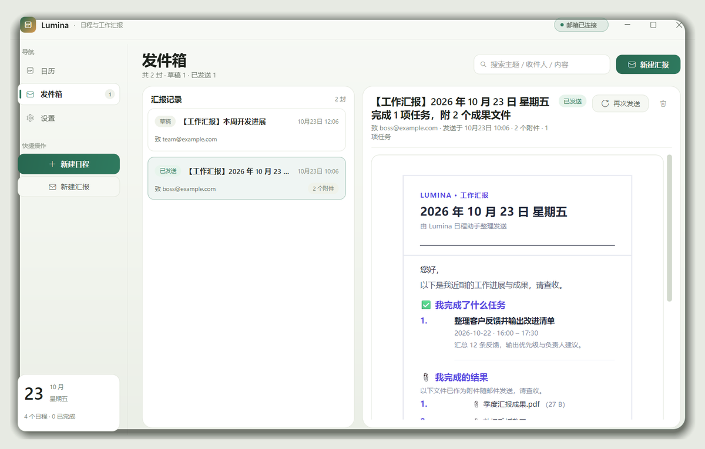
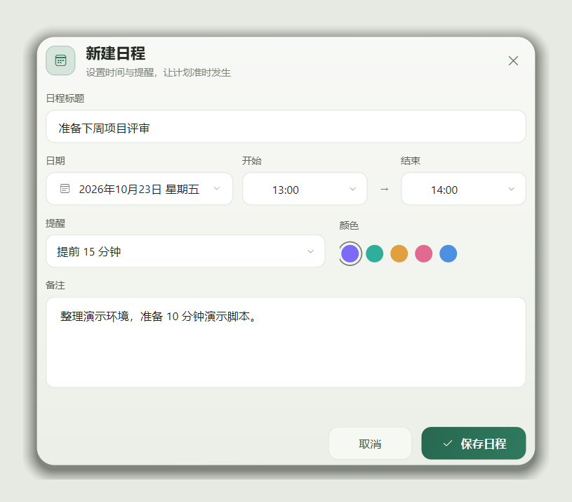
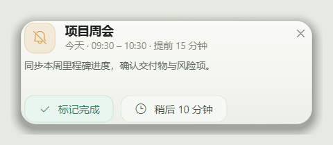
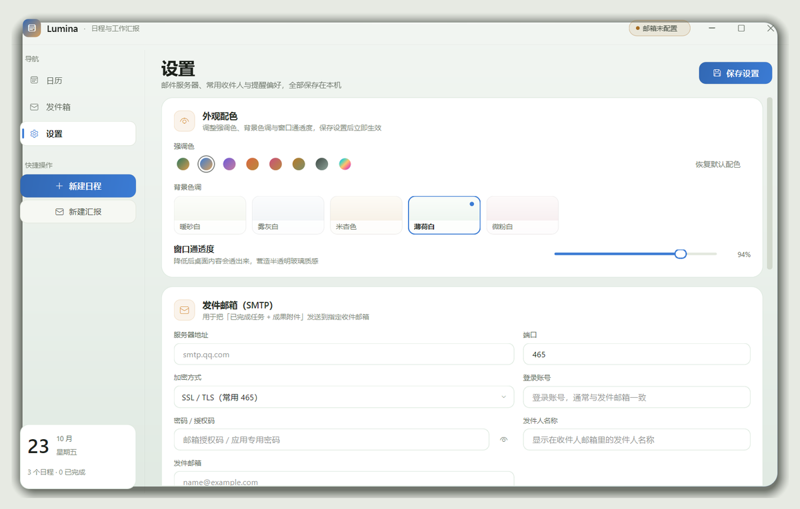
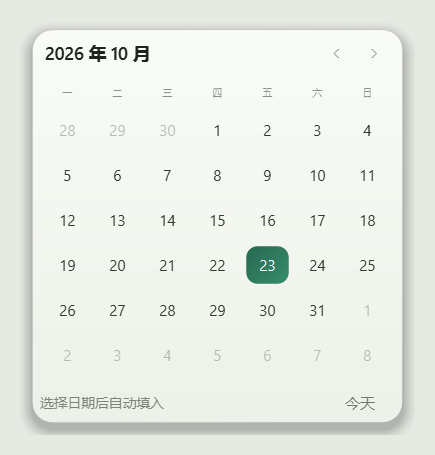

# DanLume · 日程与工作汇报

<p align="left">
  
  
  
  
</p>

本地优先的 Windows 桌面应用：把**日历、邮箱、教务通知、备忘、作业、eHall、空教室、
文档、文献库、公式排版、AI 助手**收在同一个窗口里。界面是浅色圆角 + 磨砂的现代风格，
支持浅色 / 深色 / 跟随系统、自定义强调色与通透度；所有数据存在本机 SQLite，
密码用 Windows DPAPI 加密。


## 页面一览

左侧导航按使用顺序排：

| 页面 | 能做什么 |
| --- | --- |
| 仪表板 | 今天做什么，一眼看完：日期与教学周、天气、未来 3 天日程、最近教务通知、最近作业、eHall 小组件卡 |
| 日历 | 月视图 / 周视图（课表式）、重复日程、桌面提醒、出发提醒 |
| 邮箱 | 收件箱（IMAP 多账户、HTML 排版、内联图片、附件）、发件箱、工作汇报邮件 |
| 通知 | 教务与 eHall 的通知流，「抓取」「全部标为已读」「只看未读」 |
| 备忘 | 速记本：标题、加粗 / 斜体 / 下划线、字号、颜色、列表、待办，自动保存 |
| 作业 | eLearning：读取课程、一键下载所有作业、打开本地文件、截止时间写入日程 |
| eHall | 内嵌 eHall 网页，登录状态持久化 |
| 空教室 | 校区 → 教学楼 → 教室三级筛选，整段时间轴看哪间空着 |
| 文档 | PDF / Word / PPT / Excel / 文本的浏览入口，PDF 内置预览 |
| 文献库 | 5 栏目录式文献管理：星级、多选、自动中文概述、流程图、引用导出 |
| 公式 | 文档编辑器 + LaTeX：左写右预览，按钮式排版、图形化矩阵、宏包勾选 |
| AI | 右侧栏：API 服务 / WebUI 对话 / 系统提示词三个标签页 |
| 设置 | 20 张设置卡，支持搜索（搜 `vpn`、`字体`、`key` 都能直接跳过去） |

## 功能详解

### 仪表板

- 「今天」卡：日期、第几周、今天还剩几个日程；「天气」卡：上海天气与风力。
- 「即将到来」看未来 3 天：**已经开始的日程写「进行中」**（主题色，不再显示开始时间），
  还没开始的显示「日期 + 开始时间」；已经结束的不占位置。
- 「教务信息」是最近 5 条通知；「最近作业」直接读
  eLearning 仪表板（`elearning.fudan.edu.cn/dash`）右侧的 To Do。
- **通知和作业都是超链接**：点通知去 eHall，点作业去 eLearning（不是 ehall）。
- 下面是 eHall 小组件卡：校园卡余额、校车安排、体育刷锻、图书馆人数、
  我的 ehall 通知、空教室。**每张卡的数据来源地址在「设置 → 仪表板」里填一次**
  （在 eHall 里打开对应服务，复制地址栏）；填完点「同步 ehall」就出数。
  取不到会写清是「没登录 / 地址不对 / 页面上没有」。
- 顶部有「登录 eHall」：掉登录态时可以就地补登录。

### 日历

- 月视图与**周视图**（行＝节次、列＝周一到周日），选过哪种会记住。
- 日程：标题、日期、起止时间、地点、备注、5 种颜色、提醒提前量。
- **重复日程**：不重复 / 每天 / 每周 / 每月 / 每年，只存一条、日历按规则展开
  （1 月 31 日在没 31 号的月份自动跳过）。
- 删除重复日程可选**只删这一次 / 删除这次及以后 / 删除全部**。
- 提醒：准时、提前 5 / 15 / 30 分钟、提前 1 小时、提前 1 天；每 20 秒检查一次，
  右下角弹主题气泡卡片，可「标记完成」或「稍后 10 分钟」。
- **出发提醒**：按课程地点估步行 / 骑行距离和时间，上课前提示「该出发了」。

### 邮箱

- **收件箱**：多 IMAP 账户；邮件按 **UID** 取信与缓存（新邮件到达不会串正文）；
  正文按原本的 HTML 排版渲染，内联图片能显示，远程图片自动下载到本地；
  图片**双击打开独立窗口**看大图；附件是「类型徽标 + 文件名 + 大小」的小卡，点一下保存。
- **发件箱**：草稿 / 已发送 / 发送失败；失败会写可读的中文原因，可直接重试。
- **工作汇报**：勾选近期日程生成「我完成了什么任务」，上传成果文件作为「我完成的结果」，
  自动生成主题（可改），通过你配的 SMTP 发送。
- 邮件正文会做**安全清洗**：去掉脚本 / iframe / 事件属性；表格宽度按 Qt 能渲染的方式
  归一化（不然「响应式模板邮件」会被压成一列单字）；下不来的远程图片直接删掉，
  不留破图占位。

### 作业（eLearning）

- 内嵌 eLearning 网页登录，登录态持久化。
- 「读取我的课程」：拉课程与作业清单，会存一份（重启先显示上次读到的）。
- 「一键下载所有作业」：课程文件 + 作业描述里的附件，**重名跳过**，最后告知跳过几个。
- 「打开」：按 **本地索引 → 作业附件名 → 作业名 → 同课程周次编号** 依次找文件
  （所以「第八周作业」能找到 `HW8.2.pdf`）；对上多个文件会弹候选菜单让你挑；
  一个都没有就打开下载目录并说明里面有多少文件。
- 「截止写入日程」＋「每天自动」：把 dash 上作业的 deadline 写进日历。
  标题是「作业截止：课程 · 作业名」，**时间范围是「截止前 30 分钟 → 截止时间」**
  （一眼看出「再过半小时要交」），提醒落在块的开始；重复的不重复加、
  日程被删了下次会补回来，旧格式（截止 → 截止+30 分钟）的块会自动改成新范围。

### eHall 与空教室

- **eHall**：内嵌网页，登录状态持久化，掉登录可在页面里补。
- **空教室**：选 **校区 → 教学楼 → 教室**（回车即查，也可点「查看」），
  右边是**横向时间轴**：一行一间教室，按节次排，被占用的时段画成浅玫瑰色块并写课程名，
  空着的是淡绿；鼠标悬停看「哪间教室 · 第几节 · 什么课 · 教师 · 时段」；
  「放大查看」弹出大窗；「设为首页」记住地址。学校网页默认收起（右上角可打开）。

### 通知与备忘

- **通知**：教务 / eHall 通知流，「抓取」「全部标为已读」「只看未读」，点条目跳原文。
- **备忘**：左边列表、右边富文本编辑（标题、加粗、斜体、下划线、字号、颜色、
  有序 / 无序列表、待办清单），输入即自动保存。

### 文档 / 文献库 / 公式

- **文档**：文件列表 + 目录，PDF 内置预览（翻页、全屏），其它格式交给系统默认程序。
- **文献库**：项目目录 + 文献列表 + 详情面板；星级、勾选、全选 / 全不选 /
  已选 N 篇 / 星级筛选；自动生成中文概述；复制 GB/T 7714 引用、复制 BibTeX、
  导出 EndNote、打开 PDF；还能用「生成流程图」把一篇文献的步骤画成竖排流程图。
- **公式**：文档编辑器（左「文档视图」右「预览」）+ 按钮式排版（字体、字号、
  加粗 / 斜体 / 下划线、左中右、行内 / 行间公式、分式、根号、上下标、Σ / Π / ∫、
  向量 / 范数 / 内积、分段、方程组、表格、图片、源码片段）；
  **图形化矩阵**（像填表格，↑↓←→ 换格、Tab 下一格、可粘贴 Excel/TSV 整块）；
  宏包用下拉勾选（amsmath、amssymb、bm、graphicx、booktabs…）；
  编译用本机 XeLaTeX，可导出 `.tex`。

### AI 助手（右侧栏）

- 三个标签页：**API 服务 / WebUI 对话 / 系统提示词**（默认停在 API 服务）。
- 支持 **Markdown 与 LaTeX 公式**：行内 `$…$`、行间 `$$…$$`、`\(…\)`、`\[…\]`、
  裸 `\begin{pmatrix}` 都能识别；公式在后台线程渲染成图片、按屏幕缩放插入
  （高分屏不糊），生成过程中会预取。
- 思考过程、工具调用各一张可折叠的淡色卡片；顶栏只有一个「⋯」菜单
  （思考模式、让 AI 动手、显示思考过程、新对话、清空、历史会话、读取微信消息）。
- 输入框可 **Ctrl+V 粘贴图片 / 文档**，附件会一直带着（不用每次重传），
  用户消息上方以小图 / 类型图标显示传了什么。
- 生成时**往上翻不会被拽回底部**，想回到底部点「回到底部」。
- 统计用中文：「首字 7.11s · 608 字/秒」。

### 账号与权限

- 客户端版**不能自己新建账户**：在登录页「注册账户」提交申请，管理员批准后收到验证码与回执。
- 管理员在「设置 → 账户与登录 → 用户审核」里批准 / 拒绝申请。
- **所有限制对管理员开放**：管理员可以直接改任何设置、看任何页面。

### 外观 / 专注 / 托盘

- 浅色 / 深色 / 自动（跟随系统）；标题栏右侧一键切换。
- 8 套强调色 + 任意自定义色；背景色调 6 套；窗口不透明度；背景模糊度；磨砂玻璃；
  浏览器风格（内嵌网页浅色 / 深色）；字体搭配、中文字体、西文字体分开选。
- 外观改动**点一下就生效并立刻保存**（不用再点「保存设置」）。
- **专注模式**：桌面悬浮计时器，离开太久会提醒。
- 关闭窗口默认收进**系统托盘**，右键托盘图标才有「显示主窗口 / 退出」。

## 界面预览

| 日历 | 编写汇报邮件 |
| --- | --- |
|  |  |

| 发件箱预览 | 设置与配色 |
| --- | --- |
|  |  |

| 新建日程 | 桌面提醒 |
| --- | --- |
|  |  |

| 更换为蓝色强调色 | 日期选择弹层 |
| --- | --- |
|  |  |

| 通知（教务 / eHall） | 文献库 |
| --- | --- |
|  |  |

| 公式 | 空教室 |
| --- | --- |
|  |  |

> 页面级截图（`py-*.png`）是 2026-11-10 用 `python _py_shots.py --all` 重拍的：
> **空数据目录 + 浅色主题**，所以图里没有个人日程；对话框类截图（编写汇报 / 新建日程 / 提醒 / 日期弹层）
> 是旧图，界面没变所以没重拍。重拍时务必先设 `LUMINA_DATA_DIR` 到临时目录，别把真实数据拍进去。

> 截图使用首次启动的示例数据生成，不含真实账户信息。

## 快速开始

### 环境要求

- Windows 10 / 11
- Python 3.9 或更高（已在 Python 3.9 + PySide6 6.10 上验证）
- 依赖：`PySide6`（自带 QtWebEngine / QtPdf）、`cryptography`、`requests`
- 想用「公式」页的实时预览，需要本机装有 **XeLaTeX**（MiKTeX 或 TeX Live，
  并把 `xelatex` 放进 PATH）

### 安装与运行

```powershell
python -m pip install -r requirements.txt
python main.py
```

也可以直接双击 `启动 DanLume.bat`（英文名 `start.bat`）：第一次会自动装依赖，
之后直接启动（用 `pythonw`，不弹控制台）。

- 看控制台日志：`python main.py`，或双击 `启动 DanLume（调试）.bat` / `start-debug.bat`
- 环境 / 账户 / 日志体检（不开界面，可导出诊断包）：`诊断.bat` / `diagnose.bat`
- 打包版冒烟自检（不显示窗口）：`python main.py --smoke-test`

首次启动会写入几条示例日程和一个示例联系人，方便直接体验，都可以在界面里删除。

## 首次配置

「设置」页每张卡都可以单独改，常用的几处：

| 想做什么 | 去哪里 |
| --- | --- |
| 发邮件 / 工作汇报 | 设置 → 发件邮箱（SMTP） |
| 收邮件 | 设置 → 收件箱（IMAP），支持多个账户 |
| 课表、周次 | 设置 → 课表 |
| eHall 各服务卡的数据来源 | 设置 → 仪表板 |
| 登录态自动填充 | 设置 → 统一身份认证 |
| AI 对话用哪家模型 | 设置 → AI（API 服务），可以存多套配置 |
| 系统提示词 | 设置 → AI → 系统提示词 |
| 数据目录、备份 | 设置 → 其他 → 数据与备份 |

**SMTP 常用服务器**：

| 邮箱服务 | 服务器 | 端口 | 加密 | 密码说明 |
| --- | --- | --- | --- | --- |
| QQ 邮箱 | `smtp.qq.com` | 465 | SSL/TLS | 网页版开启 SMTP 后得到的**授权码** |
| 163 邮箱 | `smtp.163.com` | 465 | SSL/TLS | 客户端**授权码** |
| 126 邮箱 | `smtp.126.com` | 465 | SSL/TLS | 客户端**授权码** |
| Gmail | `smtp.gmail.com` | 587 | STARTTLS | Google **应用专用密码** |
| Outlook / Microsoft 365 | `smtp.office365.com` | 587 | STARTTLS | 多数租户已禁用基础认证 |

> QQ / 163 / 126 请务必用「授权码」，不要用网页登录密码。

## 数据与隐私

- 数据库：`data/lumina.db`（SQLite）。打包版默认在 exe 同级的 `data/`；
  也可以用环境变量 `LUMINA_DATA_DIR` 或「设置 → 其他 → 数据目录」指定；
  客户端包另有一个 `%LOCALAPPDATA%\DanLume\data_dir.txt` 指针文件。
- 其它目录（都在数据目录下）：`mail_media/`（邮件正文图片与附件缓存）、
  `elearning/`（作业下载，默认就是「下载目录」）、`latex_build/`（LaTeX 编译中间文件）、
  `latex_math/`（公式图片缓存）、`browser/`（内嵌浏览器的登录态 cookie）。
- **密码一律加密存储**：SMTP 密码、IMAP 授权码、AI 的 API Key、统一身份认证密码、
  代理密码都用 Windows DPAPI（`CryptProtectData`）加密，密文与当前 Windows 用户绑定；
  **设置里只能修改、看不到原密码**。
- 汇报邮件的附件记录的是原文件路径（不复制），移动或删除源文件后需要重新添加。
- 备份：关闭应用后复制整个数据目录即可；恢复时放回原位。
  **删除 `data/lumina.db` 会清空全部本地记录。**

## 项目结构

```text
.
├── main.py                     # 入口（--smoke-test / --diagnose / --debug）
├── lumina/                     # 应用代码（126 个模块）
│   ├── config.py               # 常量与数据目录
│   ├── theme.py                # 浅/深色主题、Apple 系统色、字体、全局样式表
│   ├── store.py                # SQLite 数据层
│   ├── secure.py               # Windows DPAPI 加密
│   ├── main_window.py          # 无边框主窗口、左侧导航、右侧栏、托盘
│   ├── widgets.py              # 圆角卡片、按钮、下拉弹层、自绘提示框
│   ├── page_dashboard.py       # 仪表板
│   ├── page_calendar.py        # 日历（月 / 周）
│   ├── page_mailbox.py         # 邮箱（inbox_panel / page_outbox）
│   ├── page_notices.py         # 通知
│   ├── page_memos.py           # 备忘
│   ├── page_homework.py        # 作业（elearning.py / elearn_schedule.py）
│   ├── page_ehall.py           # eHall（ehall_bridge.py 负责取数）
│   ├── page_classroom.py       # 空教室（classroom_view.py 画时间轴）
│   ├── page_docs.py            # 文档（docs_reader.py）
│   ├── page_lit.py             # 文献库（lit.py / lit_flow.py）
│   ├── page_latex.py           # 公式 / 文档编辑器（latex_*.py）
│   ├── ai_panel.py             # AI 三个标签页（ai_api_panel / chat_view / chat_math）
│   ├── page_settings.py        # 设置（20 张卡 + 搜索）
│   ├── reminders.py            # 提醒轮询
│   ├── mailer.py               # 邮件构建与 SMTP 发送
│   ├── imap_inbox.py           # IMAP 收件与缓存
│   └── mail_html.py            # 邮件 HTML 清洗
├── assets/                     # 图标与字体
├── docs/screenshots/           # README 截图
├── requirements.txt
├── 启动 DanLume.bat / start.bat
├── 启动 DanLume（调试）.bat / start-debug.bat
├── 诊断.bat / diagnose.bat
└── build_exe.ps1
```

## 测试

开发仓根目录有一套自检脚本（**151 个** `_t_*.py`，每个脚本自己建临时数据目录，
不会碰你的 `data/`）：

```powershell
python _run_all_tests.py            # 跑全部并写 _test-report.txt
python _t_mailtable.py              # 也可以单独跑某一个
```

约定：脚本里会设 `LUMINA_SMOKE=1` / `LUMINA_NO_OPEN=1`，测试期间**不弹窗、
不真的打开文件或链接**；断言全过时打印 `ALL OK`。

`_verify_dist.py` 用来确认「新代码真在包里」：它会在打好的 exe 的 PYZ 里
逐个模块检查关键符号。

## 打包

```powershell
python -m pip install -r requirements-dev.txt
cd _build\Lumina
powershell -ExecutionPolicy Bypass -File .\build_client_exe.ps1
```

产物在 `_build\Lumina\dist\DanLume\DanLume.exe`，再由 `_pack_client.py` /
`_pack_source.py` 打成 `_dist` 下的两个 zip，`_finalize_dist.py` 负责逐条 CRC 校验、
解压后真启动一次、并写入 `SHA256.txt` 与 `本次更新.txt`。

> 构建使用 PyInstaller 的 `--windowed`；需要看控制台错误时临时改成 `--console`。

## 常见问题

**Q：发送时报错「登录被服务器拒绝（535）」？**
A：账号或密码不对。QQ / 163 / 126 要用授权码并开启 SMTP 服务，Gmail 要用应用专用密码。
先点「测试连接」确认。

**Q：邮件正文图片不显示 / 排版挤成一列？**
A：图片会在收到时下载到 `mail_media/`，下不来的远程图会被去掉（不留破图）；
「响应式模板邮件」的表格宽度会自动归一化，不会压成一列单字。老邮件重新打开一次即可。

**Q：作业页点「打开」说找不到文件，可我明明下载了？**
A：现在的查找顺序是 本地索引 → 作业附件名 → 作业名 → 同课程周次编号
（「第八周作业」↔ `HW8.2.pdf`）；对上多个会弹菜单让你挑；一个都没有就直接打开下载目录。
如果文件被挪到别处，把它放回「下载目录」（设置 → 其他 → 下载目录）即可。

**Q：公式在文档里糊 / 不在一条线上？**
A：公式按 600 DPI 渲染，再按「逻辑尺寸 × 屏幕缩放」落到设备像素，行内公式垂直居中；
行间公式在编辑区居中、导出时按正文字号缩放。

**Q：提醒没有弹出？**
A：确认应用还在运行（最小化可以）、设置里的「桌面提醒」已开、日程的提醒不是「不提醒」。

**Q：数据在哪里？怎么备份？**
A：见上面「数据与隐私」。关闭应用后复制整个数据目录即可。

**Q：支持深色主题吗？**
A：支持。浅色 / 深色 / 自动三选一，标题栏右侧太阳 / 月亮按钮可直接切换。

## 已知限制

- 重复日程的提醒只对第一次（主日程）触发，后续展开的实例不单独提醒。
- 提醒需要应用在运行；关机期间到期的提醒不会补发系统通知。
- 内嵌网页（eHall / eLearning）需要登录态；掉登录会提示你补登录。
- eHall 的校园卡、校车、刷锻、图书馆这几张卡需要先在设置里填一次地址。
- AI 与联网相关功能需要网络和你自己的 API Key / 账号。
